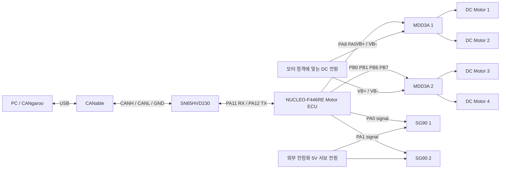

# Motor ECU 하드웨어 구성 및 Pin In / Pin Out

작성일: 2026-10-17 · 현재 Motor ECU firmware revision4 / CANgaroo script1.5 기준.

이 문서는 NUCLEO-F446RE 1대, MDD3A 2대, DC 모터 4개, 위치 제어형 SG90 2개, SN65HVD230 CAN 트랜시버 1개, CANable 1개의 시험 구성을 설명한다. **IN/OUT 방향은 MCU 기준**이며, 실제 `.ioc`와 PWM 초기화 코드에서 사용하는 핀을 정리했다. 서보 360도 연속회전형은 이 각도 제어 구성의 대상이 아니다.

## 1. 전체 구성

그림의 PWM 선은 제어 신호다. 모터와 서보의 구동 전류는 각각 외부 전원에서 공급한다. Nucleo는 ST-LINK USB로 전원을 공급하는 시험 구성을 기준으로 한다. CANable USB 전원과 Nucleo 전원을 별도로 연결한다.

## 2. MCU 신호 핀 전체표

CN7/CN10은 Nucleo의 ST morpho 헤더다. `CN10-23`은 CN10 커넥터의 23번 접점을 뜻하며 MCU 패키지 핀 번호가 아니다. 핀 번호는 [ST UM1724](https://www.st.com/resource/en/user_manual/um1724-.pdf)의 NUCLEO-F446RE 해당 표와 대조했다. 실물 PCB의 CN 표기와 1번 표시로 방향을 확인한다.

| 기능 | MCU 핀 | 헤더 | MCU 방향 | 주변기능 | 연결 대상 |
|---|---|---|---|---|---|
| CAN 수신 | PA11 | CN10-14 | IN | CAN1_RX | 트랜시버 R/RXD |
| CAN 송신 | PA12 | CN10-12 | OUT | CAN1_TX | 트랜시버 D/TXD |
| Motor1 입력 A | PA8 | CN10-23 | OUT | TIM1_CH1 | 드라이버1 제어입력 M1A |
| Motor1 입력 B | PA9 | CN10-21 | OUT | TIM1_CH2 | 드라이버1 제어입력 M1B |
| Motor2 입력 A | PB4 | CN10-27 | OUT | TIM3_CH1 | 드라이버1 제어입력 M2A |
| Motor2 입력 B | PB5 | CN10-29 | OUT | TIM3_CH2 | 드라이버1 제어입력 M2B |
| Motor3 입력 A | PB0 | CN7-34 | OUT | TIM3_CH3 | 드라이버2 제어입력 M1A |
| Motor3 입력 B | PB1 | CN10-24 | OUT | TIM3_CH4 | 드라이버2 제어입력 M1B |
| Motor4 입력 A | PB6 | CN10-17 | OUT | TIM4_CH1 | 드라이버2 제어입력 M2A |
| Motor4 입력 B | PB7 | CN7-21 | OUT | TIM4_CH2 | 드라이버2 제어입력 M2B |
| Servo1 신호 | PA0 | CN7-28 | OUT | TIM2_CH1 | SG90 1 Signal |
| Servo2 신호 | PA1 | CN7-30 | OUT | TIM2_CH2 | SG90 2 Signal |

이 12개 핀은 서로 중복되지 않는다. CAN RX/TX는 UART처럼 TX-RX 표기만 보고 임의로 교차시키지 말고 아래 트랜시버 표대로 연결한다. 논리 출력은 MCU의 3.3V 레벨이다.

## 3. MDD3A 두 대와 DC 모터 네 개

**작은 제어 핀 헤더의 M1A/M1B/M2A/M2B**에는 위 MCU 신호선을 연결한다. **모터용 나사 단자의 M1A/M1B/M2A/M2B**에는 모터의 두 전선을 연결한다. 같은 이름이어도 전기적 역할이 다르다. 제조사 [Cytron 연결 예제](https://my.cytron.io/tutorial/getting-started-mdd3a-makerdrive-motor-driver-using-arduino)도 Terminal과 제어 입력을 구분한다.

| 장치 | 모터 출력 단자 쌍 | 연결할 부하 |
|---|---|---|
| 드라이버1 | 모터용 Terminal M1A + M1B | DC Motor1의 두 선 |
| 드라이버1 | 모터용 Terminal M2A + M2B | DC Motor2의 두 선 |
| 드라이버2 | 모터용 Terminal M1A + M1B | DC Motor3의 두 선 |
| 드라이버2 | 모터용 Terminal M2A + M2B | DC Motor4의 두 선 |

각 드라이버의 VB+에는 모터 전원 +, VB-에는 모터 전원 -를 연결하고 제어 GND도 공통 기준에 연결한다. MDD3A의 전원 동작 범위는 4~16V이지만 **실제 공급 전압은 모터 명판 정격과 드라이버 허용 범위를 함께 만족하도록 선택**한다. 현재 DC 모터의 정확한 모델/정격 전압은 확인되지 않았으므로 6V 또는 12V로 확정하지 않는다. [Cytron 제품 분류](https://www.cytron.io/c-motor-driver/c-dc-motor-driver)

현재 코드의 채널별 출력은 다음과 같다.

| 요청 | 제어입력 A | 제어입력 B |
|---|---|---|
| D / 전진 | 20kHz PWM | LOW |
| R / 후진 | LOW | 20kHz PWM |
| P/N/Brake/통신 timeout | LOW | LOW |

A/B 두 입력을 모두 연결해야 전·후진을 사용할 수 있다. 회전 방향 이름은 모터 배선/장착에 따라 달라지며, 반대라면 전원 차단 후 해당 모터 출력 두 선을 바꾸거나 `MOTOR_DIRECTION_INVERT_MASK`로 해당 채널을 보정한다. 네 모터는 현재 같은 크기의 PWM 요청을 받으며 개별 속도 명령은 없다. 반전 전 소프트웨어가 200ms zero-output 구간을 확보한다. LOW/LOW는 펌웨어의 출력 차단 상태를 뜻하며 실제 기계 정지 시간이나 제동 성능을 보장하지 않는다.

**MDD3A의 `5Vo/5V0`는 전원 출력이다.** 현재 구성에서는 사용하지 않는다. 외부 서보 전원 또는 USB로 구동 중인 Nucleo의 5V 레일에 연결하지 않는다. 드라이버 출력으로부터 모터 전원이나 서보 전원을 역으로 공급하지 않는다.

## 4. SG90 두 개

| 서보 선 | 일반적인 색상 | Servo1 | Servo2 |
|---|---|---|---|
| Signal | 주황/노랑 | PA0, CN7-28 | PA1, CN7-30 |
| V+ | 빨강 | 외부 서보 전원 +5V | 같은 서보 전원 +5V |
| GND | 갈색/검정 | 서보 전원 - 및 공통 GND | 서보 전원 - 및 공통 GND |

색상은 일반적인 예이며 실제 제품의 커넥터 표기를 우선한다. 두 서보의 전원은 병렬 연결하고 두 신호선은 각각의 MCU 핀에 연결한다. 제조사 SG90 자료는 4.8V 동작 및 외부 어댑터 공급을 설명하며, 제조사 답변은 4.8~6V 사용을 안내한다. 이 구성은 **제품 허용 전압을 확인한 위치 제어형 SG90에 안정화된 외부 5V**를 공급한다. 정확한 제품이 SG350Q 등 다른 모델이라면 해당 데이터시트를 적용한다. [TowerPro SG90](https://towerpro.com.tw/product/sg90-7/)

서보 전류를 MCU GPIO/3.3V 핀에서 공급하지 않는다. 전원 용량은 두 서보의 동시 기동·부하 전류에 맞추고 실물에서 전압 강하를 확인한다. 두 개 합계 전류를 임의의 작은 값으로 가정하지 않는다. 3.3V PWM 입력 호환성은 실제 제품에서 확인하며 필요한 경우 3.3V→서보 입력용 단방향 레벨 변환을 추가한다. 신호 핀에 외부 5V를 직접 공급하지 않는다.

현재 펌웨어의 PWM은 50Hz, 주기20ms, 중앙1500µs이다. 논리 요청 -45도/0도/+45도는 1250/1500/1750µs로 변환한다. 이 각도는 실제 축/바퀴 각도를 측정한 값이 아니다. 두 서보는 같은 요청을 사용하며 서로 거울상으로 장착했다면 `SERVO_DIRECTION_INVERT_MASK`의 bit0/bit1로 반전한다. `SERVO1_CENTER_US`, `SERVO2_CENTER_US`로 개별 중앙을 보정한다. 부팅 및 통신 inhibit 시 중앙 펄스를 출력하므로 전원을 넣자마자 중앙으로 움직일 수 있다.

## 5. CAN 트랜시버와 CANable

| 출발 | 연결 대상 | 의미 |
|---|---|---|
| Nucleo PA12, CN10-12 | SN65HVD230 D/TXD | MCU 송신 → 트랜시버 입력 |
| SN65HVD230 R/RXD | Nucleo PA11, CN10-14 | 트랜시버 출력 → MCU 수신 |
| Nucleo 3.3V, CN7-16 | 트랜시버 VCC | 3.3V 전원 |
| 공통 GND | 트랜시버 GND, CANable GND | 기준 전위 |
| 트랜시버 CANH | CANable CANH / 전체 버스 CANH | 버스 H |
| 트랜시버 CANL | CANable CANL / 전체 버스 CANL | 버스 L |

SN65HVD230은 3.3V 부품이므로 VCC에 5V를 넣지 않는다. 모듈의 RS 제어가 노출되어 있다면 normal transmit 가능한 상태인지 확인한다. IC 기준으로 RS HIGH는 standby/listen-only이며 RS를 GND로 두면 high-speed mode가 된다. 모듈 내 저항/점퍼 구성은 실물 회로에 맞춘다. [TI SN65HVD230](https://www.ti.com/product/SN65HVD230)

CAN 버스는 CANH/CANL 쌍으로 연결하고 **물리적 양 끝에만 120Ω 종단 각1개**를 둔다. CANable이나 모듈에 이미 종단이 있으면 합산한다. 모든 장치 전원을 끈 뒤 CANH-CANL 저항이 약60Ω이면 두 개의 120Ω 병렬 종단이 있는지 확인하는 데 도움이 된다. 이것만으로 전체 배선 정상 여부가 확정되지는 않는다. 중간 노드마다 종단을 추가하지 않는다.

CANgaroo는 현재 사용자 환경에서 COM4/SLCAN, 500kbps, Listen-only 해제 상태로 Measurement를 시작한다. COM 번호와 interface ID256은 다른 PC/재연결 후 바뀔 수 있으므로 목록에서 확인한다. MCU CAN TX/RX를 CANH/CANL에 직접 연결하지 않는다.

## 6. 전원 및 GND 구성

| 전원/기준 | 공급 대상 | 이 구성의 연결 |
|---|---|---|
| PC USB → Nucleo ST-LINK USB | ECU 보드 | ECU 논리 전원 |
| PC USB → CANable | CANable | USB-CAN 전원 |
| Nucleo 3.3V | SN65HVD230 | VCC에 연결 |
| 외부 모터 전원 + | 두 MDD3A VB+ | 같은 전원에서 두 드라이버로 분기 |
| 외부 모터 전원 - | 두 MDD3A VB- | 모터 전류 귀환 |
| 외부 안정화 5V + | SG90 두 개 V+ | 병렬 분기 |
| 공통 GND 분배점 | ECU GND, 두 드라이버 GND/VB-, 서보 전원 -, 서보 GND, 트랜시버 GND, CANable GND | 같은 신호 기준 |

Nucleo GND 연결점 예시는 CN7-20이다. 같은 보드의 다른 GND 접점도 사용할 수 있다. 모터/서보의 큰 귀환 전류가 Nucleo 헤더나 얇은 신호 GND선을 경유하지 않도록, 전원 분배점으로 각각 되돌린다. **공통으로 연결하는 것은 기준 GND이며 모터 전원 +와 서보 5V +를 서로 연결하는 것이 아니다.** 하나의 모터 전원에서 서보용 DC-DC를 쓴다면 그 변환기의 출력 정격/공통접지 구조에 맞춘다.

USB로 구동하는 Nucleo의 5V 핀에 외부 5V를 추가 병렬 공급하지 않는다. 전원 선은 모터 기동/스톨 및 네 개 동시 운전 전류에 맞추고, 공급기와 배선에 맞는 전류 제한/보호를 적용한다. 모터 전력 경로를 얇은 점퍼선과 신호용 브레드보드에 집중시키지 않는다.

## 7. 다른 용도로 사용 중인 핀

| 핀 | 현재 사용 |
|---|---|
| PA2 / PA3 | USART2 TX/RX, ST-LINK 가상 COM 경로 |
| PA5 | 보드 LED |
| PA13 / PA14 | SWD 디버그 |
| PB3 | SWO |
| PC13 | 사용자 버튼 |
| PH0/PH1, PC14/PC15 | `.ioc`의 발진기 관련 설정 |

위 핀을 모터·서보 신호용으로 임의 공유하지 않는다. Motor ECU에는 현재 가속페달 ADC, 모터 엔코더, 실측 전류/토크, 서보 위치 피드백 배선을 구현하지 않았다. 가속/방향 요청은 CAN으로 들어오며 Motor_Status의 RPM/토크는 가상 모델 값이다.

## 8. CAN 명령과 물리 출력 연결

| 메시지 | 내용 | 물리 출력과의 관계 |
|---|---|---|
| 0x100 Byte0..1 | TorqueRequest, 0.1Nm | 데모 target RPM → 공통 DC PWM |
| 0x100 Byte2 | Gear/Brake/Alive | D/R 방향, 제동 요청, 수신 연속성 |
| 0x100 Byte3 | Body 명령 후보용으로 확보 | Motor는 해석하지 않음, script는0 |
| 0x100 Byte4..5 | SteeringAngle, signed0.1도 | SG90 2개의 논리 target |
| 0x100 Byte6..7 | Reserved | script는0 |
| 0x110 | 가상 RPM/토크/상태/진단 | 실제 측정 피드백은 아님 |

두 메시지는 Standard CAN/DLC8/10ms이다. firmware revision4와 script1.5의 조합을 사용한다. 관련 규격은 [조향 인터페이스](../../network/can/MOTOR_STEERING_INTERFACE.md)를 따른다.

## 9. 최초 연결 및 종료 확인표

- [ ] 전원을 끈 상태에서 MCU 핀과 CN7/CN10 접점을 확인했다.
- [ ] MDD3A의 작은 제어 헤더와 모터용 출력 단자를 구분했다.
- [ ] A/B 입력8개와 모터 출력4쌍을 모두 연결했다.
- [ ] 모터 정격과 VB 공급 전압, 서보 제품 정격과 외부5V를 확인했다.
- [ ] 트랜시버 VCC는3.3V이고 PA12→D, R→PA11이다.
- [ ] 공통 GND를 연결하고 전력 귀환은 분리했다.
- [ ] CANH/CANL과 양 끝 종단을 확인했다.
- [ ] 바퀴를 띄우고 서보 링크의 중앙/가동 범위를 확보했다.
- [ ] 새 펌웨어를 실행하고 CANgaroo에서 interface 번호(현재256)를 먼저 선택했다.
- [ ] `status`에서 revision4/READY/fresh 상태를 확인했다.
- [ ] `left 10 3`, `center`, `right 10 3`, `center`로 서보를 먼저 확인했다.
- [ ] `d 10 3` 후 `s`로 DC 방향/정지를 확인했다. 낮은 duty에서는 기동하지 않을 수 있다.
- [ ] `auto`는 전진·후진과 좌우 조향이 계속 반복된다는 것을 확인했다.
- [ ] 종료 시 `s` → `quit` → 모터·서보 외부 전원 OFF 순서로 정리했다.

## 10. 기준 소스와 확인 범위

소스 기준: `firmware/motor_ECU/motor_ECU.ioc`, `Core/Src/main.c`의 `motor_pwm_init()`/`MotorBoard_Apply()`, `Core/Src/motor_app.c`, `Core/Src/motor_can.c`, `cangaroo/motor_control.py`.

코드/설정과 제조사 핀 자료를 대조한 연결 문서이며 실물 배선 사진이나 회로 전수 검증 결과는 아니다. 이전 검토의 CPU 예외 시 PWM 차단, CAN bus-off 복구, 복구 계수 기준 문제는 별도 미해결 항목이다. 이 문서 작성으로 해당 기능이 추가되지는 않았다.
