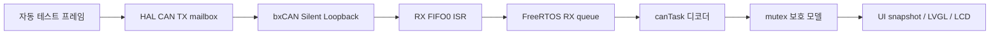

# Cluster ECU 구현 및 검증 현황

작성일: 2026-10-11

기준: 로컬 `firmware/cluster_ECU`의 현재 코드, `CLUSTER_REVIEW_FIXES.md`, `CLUSTER_RTOS_TASKS.md`, `CLUSTER_CAN_LOOPBACK.md`, 2026-10-11 문서 대조 리뷰. 시스템 문서 검토 기준은 develop 커밋 `226e88e076171037d9e115e9722ec3cbdc18e268`이며, 그 이후 모든 원격 문서 변경을 재검토했다는 의미는 아니다.

## 현재 판정

LCD 표시, CAN 디코더, FreeRTOS 태스크 분리, 내부 CAN 루프백 테스트까지 구현하고 보드에서 확인했다. 외부 CAN 버스 및 Gateway 통합 시험은 남아 있으므로 전체 개발 완료로 판정하지 않는다.

현재 `CLUSTER_CAN_LOOPBACK=1`, `CLUSTER_TEST_INPUT=1`, CAN1 `CAN_MODE_SILENT_LOOPBACK`이다. MCU가 테스트 프레임을 자동 생성하므로 외부 입력 없이 속도·RPM·Fault가 변한다. Uptime은 실행 시간이다.

## 하드웨어와 주변장치

| 항목 | 현재 구성 |
|---|---|
| MCU/보드 | STM32F446RE / NUCLEO-F446RE |
| LCD | ST7796S SPI, 480×320, 모듈 V1.1 |
| 터치 | XPT2046 탑재; 현재 펌웨어에서 미사용 |
| 표시 라이브러리 | LVGL v9.6.0, RGB565, 부분 갱신 |
| 클록 | SYSCLK 84 MHz, PCLK1 42 MHz, PCLK2 84 MHz |
| SPI2 | Mode 0, Software NSS, /8, 5.25 MHz |
| TFT 신호 | SCK PB13, MOSI PB15, MISO PB14, CS PB12, DC/RS PC6, RESET PC7 |
| CAN1 | RX PA11, TX PA12, 500 kbps 설정; 현재 Silent Loopback |
| CAN timing | Prescaler 6, BS1 11 TQ, BS2 2 TQ, SJW 1 TQ |
| HAL / RTOS 시간 | HAL TIM6, FreeRTOS SysTick |

LCD LED 연결 후 백라이트가 켜졌고 단색 테스트와 UI 표시를 실물로 확인했다. 전원/LED 결선은 모듈의 실제 전기 사양을 기준으로 유지한다. 위 MISO 핀 배정은 현재 표시 드라이버가 LCD 읽기를 검증했다는 의미가 아니다.

## FreeRTOS 구성

| 실행 주체 | 역할 | 우선순위/메모리 |
|---|---|---|
| defaultTask | LCD/LVGL 초기화·갱신, 상태 snapshot, LED 진단 | Normal, stack 8192 B |
| canTask | CAN 초기화, RX queue 처리, 모델 갱신, 루프백 테스트 입력 | AboveNormal, stack 2048 B, 서비스 주기 5 ms |
| CAN RX ISR | 프레임과 원래 수신 시각을 큐에 저장 | IRQ priority 5, nonblocking enqueue |

- RX queue는 64개 프레임을 보관한다. ID/DLC/EXT/RTR/수신 시각을 Task까지 전달한다.
- 공유 모델은 priority inheritance mutex로 보호한다.
- UI는 snapshot 복사 직후 잠금을 풀고 LVGL/SPI를 수행한다. ISR은 mutex나 LVGL을 호출하지 않는다.
- LVGL/SPI의 소유자는 UI Task 하나다. 별도 SPI mutex는 현재 구조에서 필요하지 않다.
- CAN Task는 UI 초기 화면 완료 후 thread flag로 시작한다.
- SPI 전송은 blocking이다. SPI TX DMA 설정이 있어도 현재 표시 전송을 DMA로 구현한 것은 아니다. DMA 완료 semaphore는 추가하지 않았다.

## CAN 및 데이터 모델

현재 승인 DBC 기준 수신 ID: `0x100`, `0x110`, `0x120`, `0x200`, `0x300`, `0x310`. Standard DATA, DLC 8, Intel 배치의 24개 신호를 처리한다. 정확한 신호 이름/배치는 승인 DBC가 기준이다.

- Vehicle/Motor/VCU/Body/Gateway 및 Fault 표시 모델 구현.
- raw 정수 보존 후 속도·토크 등 배율을 표시 단계에서 적용.
- Gear, Window, Door, Light의 RESERVED/UNDEFINED/INVALID 구분.
- Brake 0/1과 Alive 0..15 wrap 처리; Light raw 63은 정상 전체 ON.
- Fault는 code+node bitmap으로 관리. 중복 ACTIVE는 멱등 처리하고 해당 CLEARED만 해제한다.
- NONE이나 수신 timeout으로 전체 Fault 테이블을 자동 삭제하지 않는다.
- 손실/수신 공백은 테이블 불확실성으로 표시한다. 이벤트 전체 동기화는 아직 보장하지 못한다.
- 현재 DBC에 Cluster 애플리케이션 TX는 없다. 루프백 합성 TX는 시험 전용이다.

## 수정 완료한 오류

| 이슈 | 적용한 수정 |
|---|---|
| Vehicle이 stale이면 새 Fault SystemState도 UNKNOWN으로 표시됨 | fresh Vehicle/Fault 중 최신 상태 선택; 같은 시각이면 이벤트 우선 |
| snapshot보다 먼저 얻은 시각으로 최신 프레임을 OFFLINE 판정 | snapshot 이후 현재 시각 취득; producer도 잠금 취득 후 시각 확인 |
| 같은 timestamp의 다른 Fault 내용이 갱신되지 않을 수 있음 | bitmap·code·node·clear·system 등 실제 내용 비교 |
| 로컬 CAN 오류와 Gateway Health 혼동 | 로컬 CAN current error/history와 RXQ 별도 표시 |
| 이전 HAL FIFO 오류가 반복 집계될 수 있음 | 이력 저장 뒤 HAL 오류 latch reset |
| 첫 LCD flush 오류가 초기화 성공으로 처리될 수 있음 | 초기 flush 결과 반환, UI 상태 및 LED 진단 노출 |
| 트랜시버 없는 내부 loopback에서 CAN Start timeout | CAN 핀 Pull-up 반영 후 보드 재시험 통과 |

Reset 후 Uptime이 증가하는 것을 확인했다. Debug 정지 상태와 실행 상태를 구분해야 하며 Debug 실행 시 Resume(F8)가 필요할 수 있다.

## 내부 루프백 경로

직접 UI 모델에 데모 값을 넣는 경로는 루프백 모드에서 비활성화했다. CAN mode가 예상 Silent Loopback과 다르면 합성 프레임 송신 전에 초기화 실패로 처리한다.

테스트는 24초 주기로 상태를 바꾸고 마지막 6초는 cyclic 송신을 멈춘다. cyclic 시험 주기는 100 ms이며 생산 DBC의 10/20/100 ms 전송 주기를 검증하는 시험이 아니다.

## 실제 검증 결과

- ARM Debug build 및 ST-LINK 다운로드/검증/Reset 통과.
- 모델, snapshot, CAN queue 복사 startup self-test 통과.
- 약 29초 루프백 관측: TX/RX 1319/1319, TX 오류 0, RX drop 0, CAN 오류 이력 0.
- RX queue 최대 3/64. Fresh/Stale/Offline과 Fault 개수 0/1/2 관측.
- 최소 관측 free stack: UI 3536 B, CAN 1712 B. RTOS free heap 3280 B. Stack overflow 없음.
- 마지막 표시 라벨 수정 후 재빌드/다운로드 및 짧은 실행 확인 통과.
- 마지막 ELF: text 504152 B + data 388 B = Flash 504540 B, 잔여 19748 B. 정적 RAM data+bss = 74936 B.

위 수치는 저부하 데모의 관측값이다. 장시간·실제 nominal CAN·burst 조건의 최악 성능 보증으로 사용하지 않는다. RTOS/LVGL 메모리 pool은 정적 RAM에 포함되므로 중복 합산하지 않는다.

## Git 작업과 설정 충돌

develop merge 후 origin/Cluster_ECU pull 시 로컬 IDE 설정 때문에 pull이 막혔다. Stash 복원 중 `language.settings.xml` 두 곳이 충돌했다. 두 버전은 `env-hash`만 달랐으며 로컬 값을 유지하고 충돌 표시를 제거했다. XML 및 Git 충돌 해제 확인 완료. 펌웨어 코드 충돌은 아니었다. 이 정리 작업에서 commit/push를 실행하지 않았다.

## 관련 문서

- [앞으로 진행할 작업](02_앞으로_진행할_작업.md)
- [설계 공백 및 팀 결정](03_설계_공백_및_팀_결정.md)
- 프로젝트 기존 문서: `CLUSTER_CAN_LOOPBACK.md`, `CLUSTER_REVIEW_FIXES.md`, `CLUSTER_RTOS_TASKS.md`.
- 기존 RTOS/리뷰 문서의 “TEST_INPUT만 0으로 변경” 또는 미검증 설명은 작성 시점 기록이다. 현재 외부 CAN 전환은 두 매크로와 IOC mode를 함께 바꾼다.
