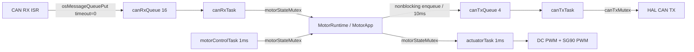

# Motor ECU CMSIS-RTOS2 integration

CMSIS-RTOS v1에서 **CMSIS-RTOS2 API**로 전환했다. FreeRTOS 커널은 기존 V10.3.1을 유지한다.
STM32Cube FW_F4 V1.28.3 패키지의 `CMSIS_RTOS_V2` 어댑터를 수정 없이 포함했다.
기존 v1 어댑터는 파일 보존 상태이며 Debug/Release의 소스 경로에서 제외했다.

## Task와 자원 소유권

| Task | 우선순위 | Stack bytes | 동작 |
|---|---|---:|---|
| actuatorTask | High1 (41) | 1024 | 1ms 주기: DC 4개·SG90 2개 PWM 갱신, 자체 freshness 확인 |
| motorControlTask | High (40) | 2048 | 1ms 주기: watchdog/가상모터/조향 target/고장 상태 갱신, 10ms 상태 생성 |
| canRxTask | AboveNormal (32) | 1024 | 수신 큐 대기, 캡처 시각으로 명령 decode/Alive 검사 |
| canTxTask | Normal (24) | 1024 | 송신 큐 대기, HAL CAN mailbox 접수 |
| healthTask (defaultTask) | BelowNormal (16) | 1024 | 500ms: LED heartbeat, task stack 여유 측정 |

주기 task는 `osDelayUntil`을 사용한다. 기한을 놓치면 과거 회차를 연속 실행하지 않고 다음 기한으로 이동한다.
OS tick은 1kHz이며 초기화 시 이를 검사한다. PWM 파형 자체는 TIM1/3/4(20kHz), TIM2(50Hz)가 생성한다.
Task가 PWM을 소프트웨어로 토글하지 않는다.

## Mutex와 ISR 규칙

- `motorStateMutex`: RX/control/actuator가 공유하는 MotorApp을 보호한다. Priority inheritance를 사용한다.
  `MotorRuntime_Receive/Process/Apply/ReportRxLoss`와 `MotorRuntime_State()` 직접 접근은 이 mutex 안에서만 한다.
- `canTxMutex`: CAN 송신 HAL 접근을 보호한다. Priority inheritance를 사용한다.
- 두 mutex를 중첩 획득하지 않는다. 상태 mutex를 잡은 control task는 송신 큐에 timeout=0으로 넣기만 한다.
  실제 HAL 송신과 mailbox 확인은 TX task에서 수행한다.
- ISR은 mutex, 모델 계산, PWM 변경을 수행하지 않는다. CAN priority 5에서
  `osMessageQueuePut(..., timeout=0)`을 호출한다. 어댑터가 내부 FromISR와 context-switch 요청을 처리한다.
- 모든 mutex 획득은 최대 2 OS ticks까지 기다린다. 출력 task가 획득에 실패하면 DC=0, 서보 중앙 명령을 직접 적용한다.
- 정상 PWM 기록은 actuatorTask 하나가 소유한다. 시작 시 초기 설정과 치명적 오류의 safe-stop은 예외다.

## 초기화와 오류

`HAL/clock/GPIO/CAN/PWM init -> osKernelInitialize -> MX_FREERTOS_Init -> osKernelStart` 순서다.
수신 IRQ 알림은 커널 시작 후 canRxTask에서 활성화해 ISR이 미생성 큐를 사용하지 않게 했다.

RX 메시지는 ISR의 `HAL_GetTick()` 시각과 queue-loss epoch를 보존한다. dequeue 시각으로 timeout을 연장하지 않는다.
RX 큐 포화/잠금 실패로 명령이 유실되면 오래된 큐를 비우고 runtime을 재동기화한다.
포화 전 epoch의 in-flight 명령은 반영하지 않는다. Alive 기준 프레임 이후 정상 순번 3회 확인 후 복구한다.
고장 중 CAN 상태에는 `LocalFaultFlags`의 **0x8 RX_QUEUE_LOSS**가 추가된다. 기존 0x1/0x2/0x4 의미는 유지한다.

Control task의 model 갱신과 독립적으로 actuatorTask에서도 30ms command timeout을 확인한다.
TX 큐 포화 시 block하지 않고 프레임을 버린다. TX task는 생성 후 20ms를 초과한 상태 프레임을 버린다.
이는 로컬 소프트웨어 기한이며 CAN 버스 전달 보장은 아니다.
동적 할당 실패/stack overflow hook에서는 IRQ를 막고 DC 출력 차단·서보 중앙 펄스를 적용한다.

## 핵심 설정과 파일

- `Core/Src/freertos.c`: task, queue, mutex 생성 및 실행.
- `Core/Inc/motor_rtos.h`: RTOS 객체와 board 인터페이스.
- `Core/Src/main.c`: 보드 초기화, ISR 캡처, CAN/PWM 하드웨어 hook.
- `Core/Src/motor_runtime.c`: 수신/모델 처리/출력 적용을 분리했다.
- `Core/Inc/FreeRTOSConfig.h`: 56개 CMSIS 우선순위, generic task selection,
  delay-until/stack 정보 API, stack overflow/할당 실패 hook, custom SysTick handler 설정.
- `motor_ECU.ioc`: CMSIS_V2, task 5개, queue 2개, mutex 2개를 반영했다.
- `.cproject`, `.mxproject`, Debug makefiles: v2 include/소스/링커 객체로 변경했다.

HAL tick과 커널 tick은 기존 `stm32f4xx_it.c`의 SysTick 경로를 함께 사용한다.
어댑터의 별도 SysTick 구현을 끄므로 중복 핸들러나 이중 커널 tick이 없다.

## IDE에서 적용

실행 중인 Debug 세션을 종료하고 프로젝트 Refresh 후 **Clean -> Build**한다.
프로젝트 설정이 열려 있었다면 IDE에서 새로 읽어 CMSIS_RTOS_V2 include와 v1 exclusion이 반영되도록 한다.
코드는 이미 수정되어 있어 CubeMX Generate Code를 실행할 필요는 없다.
`freertos.c`는 현재 애플리케이션 task 본문을 직접 관리하므로 CubeMX 재생성 시 덮어쓰기 여부를 리뷰해야 한다.
새 ELF를 다운로드하고 Resume(F8)한다. CANgaroo v1.4 명령과 DBC ID/조향 필드는 유지된다.

디버거에서 `g_rtosApiVersion=2`와 task별 `g_rtos*StackFree`(bytes),
`g_rtosMutexTimeouts`, `g_rtosRxLockDrops`, `g_rtosTxQueueDrops`, `g_rtosTxStaleDrops`,
`g_canRxDropCount`를 관측할 수 있다. Stack 여유는 실물에서 최종 확인한다.

## 검증

- 전체 ARM Debug 재빌드: CMSIS-RTOS2 wrapper/FreeRTOS/IRQ/link 통합 확인.
- C 모델 회귀: DBC/토크/서보 펄스/timeout/Alive/반전 가드.
- `tests/test_motor_rtos.c`: 실제 task 함수와 runtime을 CMSIS2 모의 API에 연결해
  ISR 큐·mutex 소유권·획득 실패 safe-stop·출력 task의 독립 timeout·queue loss 복구·stale TX 폐기를 확인한다.
- CANgaroo 스크립트 모의 API 회귀 테스트.

모의 API 테스트는 실제 커널 선점/실물 타이밍 검증을 대체하지 않는다.
보드 다운로드, ISR 부하, 최대 mutex 보유 시간, stack 여유, PWM 파형과 실제 모터 동작은 실물 확인이 필요하다.

API 참고: [Arm CMSIS-RTOS2 mutex](https://arm-software.github.io/CMSIS_6/latest/RTOS2/group__CMSIS__RTOS__MutexMgmt.html),
[message queue](https://arm-software.github.io/CMSIS_6/latest/RTOS2/group__CMSIS__RTOS__Message.html).
